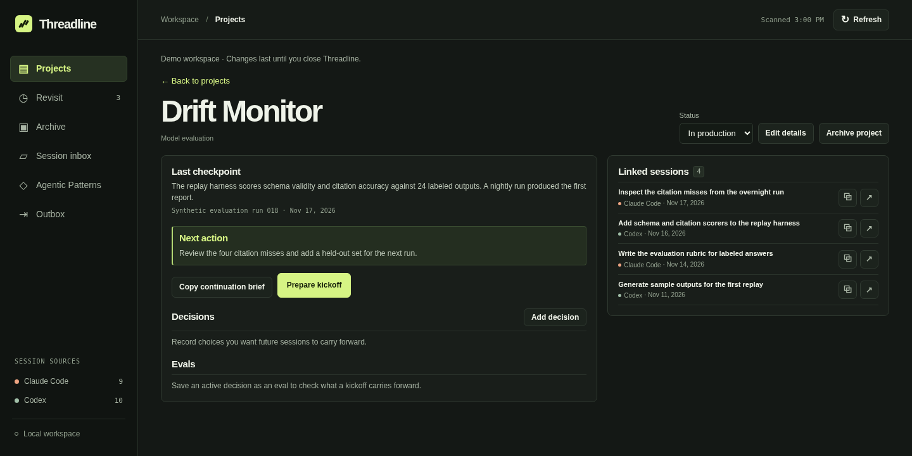

# Threadline

Threadline keeps a project register alongside your Claude Code and Codex history. Open an effort to see the last checkpoint, what to do next, and which sessions to return to.



## Try the demo

Threadline needs Python 3.11 or later. [Download v0.1.0](https://github.com/sschadwick/threadline/releases/tag/v0.1.0).

```bash
python3 threadline-0.1.0.pyz --demo
```

Open [http://127.0.0.1:8765](http://127.0.0.1:8765). The demo uses six fictional projects and synthetic session metadata. Its edits live in a temporary directory.

From a source checkout, [build the frontend](#develop) and run `python3 -m threadline --demo`.

## Use your own history

Run the archive without `--demo` or run `python3 -m threadline` from the checkout. Open the same address. Threadline starts with an empty project register and scans the history available on that machine.

1. Find related sessions in **Session inbox**. Use **Workspaces** to see checkouts with at least two unlinked sessions.
2. Choose **Track workspace** to create a project and link its sessions. You can also link individual sessions to a project.
3. Record a checkpoint and a next action when you stop work. **Revisit** surfaces open projects after 14 days without a checkpoint or linked-session activity.
4. When you return, copy a resume command for an existing session or a continuation brief for a new one.


Use **In production** to mark deployed projects and **Revisit later** to set an optional follow-up date. **Decisions** records a choice, its rationale, and supporting evidence. Superseded decisions stay in the project history. The continuation brief carries the active choices and their sources.

Choose **Save as eval** on a decision and enter a kickoff task. **Replay kickoff** checks that a brief built from the saved snapshot includes the expected decision and evidence and excludes superseded revisions. The replay runs locally and does not call a model.

## Kick off a session

Open **Agentic Patterns** or choose **Prepare kickoff** from a project. Pick a workflow, enter the task and acceptance criteria, then preview and copy the brief into a new session. The brief includes the project checkpoint and its active decisions.

On a POSIX host with an installed and authenticated Codex or Claude Code CLI, enable **Start session** for directories you trust. From a checkout with the frontend built, run:

```bash
python3 -m threadline \
  --runner codex \
  --runner-workspace /path/to/project
```

Use `--runner claude` for Claude Code. Repeat provider and workspace flags to add choices. Use a current standalone Codex CLI with support for permission profiles, or a Claude Code CLI with restricted mode. Give dashboard access to people authorized to use the host's model account. Run one service per project store. [Codex permissions](https://learn.chatgpt.com/docs/permissions) · [Claude Code CLI](https://code.claude.com/docs/en/cli-reference)

Each launch starts one read-only session with a five-minute limit and records the session ID on success. Pattern roles and later stages are instructions for the human-led workflow. Review the result in **Outbox**, where you can accept or dismiss a proposed decision or checkpoint. Accepting a checkpoint requires that the project still matches the checkpoint used for kickoff.

Threadline refreshes session activity every minute while the dashboard is visible. After you track a workspace, later sessions can match its checkout path or project name. You decide the status and next action. Manual links and unlinks take priority.

## History and storage

| Input | Default location | What Threadline reads |
| --- | --- | --- |
| Claude Code | `~/.claude` | The history index and session records used to derive titles, dates, and working directories |
| Codex | `~/.codex` | The local state database, session index, and available rollout headers |

Threadline reads from the host's filesystem. It uses `CLAUDE_CONFIG_DIR` and `CODEX_HOME` when set. Use `--claude-dir` and `--codex-dir` to point at other local directories. Compressed Codex rollouts rely on metadata in the database or index.

The dashboard serves titles, dates, and working directories to your browser. Transcript bodies stay in the source stores. Browsing history and copying kickoffs run locally. When you start a session, the selected CLI sends the reviewed kickoff and the session's working context to its model provider.

Back up `~/.local/state/threadline/state.json` to keep project edits, session links, decisions, and replay cases. Threadline honors `XDG_STATE_HOME` and supports `--data PATH` for a custom location.

## Optional Docker install

Build the image from the checkout and start the demo.

```bash
docker build --no-cache -t threadline .
docker run --rm --network host threadline --demo
```

Open [Threadline](http://127.0.0.1:8765). The container uses host networking so Threadline can bind to loopback. This works on Linux, including rootless Docker Engine 29.5 or later. On Docker Desktop 4.34 or later, enable host networking in Settings.

For your own history, mount directories containing the source records in the table above. Use a named volume for project edits.

```bash
docker run --rm --network host \
  --mount type=volume,source=threadline-data,target=/data \
  --mount "type=bind,source=/path/to/codex-history,target=/history/codex,readonly" \
  --mount "type=bind,source=/path/to/claude-history,target=/history/claude,readonly" \
  threadline
```

Replace the source paths with directories readable by the container user (UID 10001 inside the container). Include only history records. Keep agent credentials outside the mounts.

## Develop

Use Node 22 or later and Python 3.11 or later to build from source.

```bash
npm --prefix frontend ci
npm --prefix frontend run build
python3 -m unittest discover -s tests -v
python3 scripts/build_release.py
```

The Vite build writes the bundled frontend to `threadline/web/`. The release script packages it in a Python archive and writes a SHA-256 checksum under `dist/`. The archive runs with the Python standard library.

[MIT License](LICENSE)
