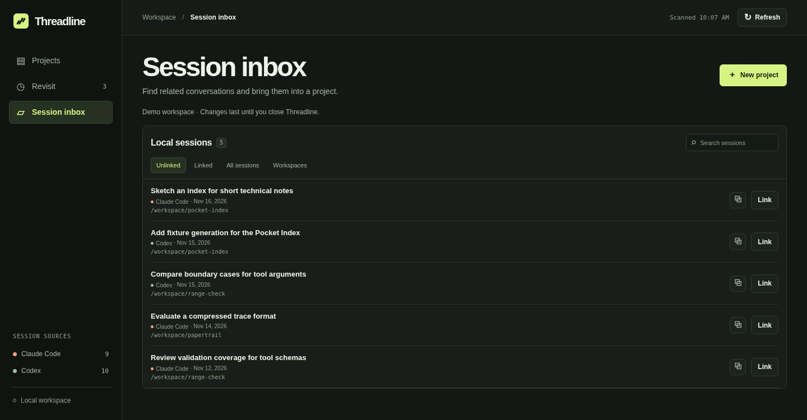

# Threadline

Threadline keeps a project register alongside your Claude Code and Codex history. Open an effort to see the last checkpoint, what to do next, and which sessions to return to.


## Try the demo

Threadline needs Python 3.11 or later. [Download v0.1.0](https://github.com/sschadwick/threadline/releases/tag/v0.1.0).

```bash
python3 threadline-0.1.0.pyz --demo
```

Open [http://127.0.0.1:8765](http://127.0.0.1:8765). The demo uses six fictional projects and synthetic session metadata. Its edits live in a temporary directory.

From a source checkout, [build the frontend](#develop) and run `python3 -m threadline --demo`.

## Use your own history

Run the archive without `--demo` or run `python3 -m threadline` from the checkout. Open the same address. Threadline starts with an empty project register and scans the history available on that machine.

1. Open **Suggested projects** to review untracked checkouts and directories with related sessions. Each suggestion shows its source, path, and supporting sessions.
2. Choose **Track project**, review the name and select the sessions to link, then confirm. Discovery never creates projects on its own. **Dismiss** hides a suggestion across refreshes and restarts; restore it from the **Dismissed** filter. You can also create a project or link individual sessions from **Session inbox**.
3. Record a checkpoint and a next action when you stop work. **Revisit** surfaces open projects after 14 days without a checkpoint or linked-session activity.
4. When you return, copy a resume command for an existing session or a continuation brief for a new one.



Open a project to change its status, including **In production**, or move it to **Archive**. Archived projects keep their history and can be restored. Use **Revisit later** to set an optional follow-up date. **Decisions** records a choice, its rationale, and supporting evidence. Superseded decisions stay in the project history. The continuation brief carries the active choices and their sources.

Filter **Linked sessions** by status and pin the session you want to resume under **Continue project**. **Needs attention** groups linked sessions waiting for input, failed runs, and proposals ready for review by project.

With an enabled runner, choose **Generate draft** to draft a new project's name, area, status, checkpoint, next action, and evidence. Opening the form, selecting sessions, or editing fields never starts generation. For a blank project, enter a name or notes first. Choose an enabled Codex or Claude Code provider; Codex drafting requires ChatGPT subscription authentication, and draft subprocesses do not receive metered API keys. Selected session metadata (up to 12 recent sessions), current project notes, and a bounded repository README and recent commit summary provide context. Transcript bodies and credentials are excluded. Typed edits survive generation and retries. Review the draft and explicitly save or track the project; generation never changes the register. Drafting is limited to one request at a time and 90 seconds, and is unavailable in demo mode.

On any project page, **Decisions and evals from sessions** can populate those sections from linked conversations. Choose up to six sessions and an enabled provider. **Preview excerpts** reads local dialogue without calling a model. **Analyze sessions** explicitly starts one bounded agent call with the sampled user/assistant messages, current project context, and existing decisions and evals. Opening the page, previewing, selecting sessions, saving proposals, and replaying evals make no model calls. Project drafting and session analysis share the one-request limit.

The agent proposes decisions with exact source quotations, including user evidence, and kickoff evals tied to proposed or existing decisions. Review citations, select the items you want, and choose **Save selected proposals**. Selecting an eval also selects its required proposed decision. Saves are atomic; existing decision history is preserved, exact duplicates are omitted, and a changed project requires fresh analysis. Proposed evals start unrun and use the existing deterministic **Replay kickoff** action. Pending proposals survive restarts and can be dismissed without applying them.

Analysis samples the beginning and recent dialogue of local, uncompressed Codex and Claude Code JSONL transcripts, up to 48,000 characters across six sessions, plus project context and up to 20 recent decisions and evals. System/instruction blocks, assistant reasoning, and tool outputs are excluded. Common credential patterns are redacted; inspect previews for other sensitive material before sending. Coverage notes identify unavailable or compressed histories and sampling limits. The agent runs in a temporary read-only workspace with integrations disabled and is instructed to use only the supplied evidence. Citations are validated against that evidence, and the agent must abstain when it is insufficient. No analysis runs automatically.

Threadline reads live Claude Code status from `claude agents --json --all` when the CLI is available. Use `--codex-socket /path/to/socket` to read live state from an existing local Codex App Server. That socket provides the status of sessions loaded by that server. The saved Codex history provides archive state. Claude Code archive state depends on the client that manages the session, and Threadline displays the live or saved status it can verify. [Claude Code Agent View](https://code.claude.com/docs/en/agent-view#list-sessions-as-json) · [Codex App Server](https://learn.chatgpt.com/docs/app-server#threads)

Choose **Save as eval** on a decision and enter a kickoff task. **Replay kickoff** checks that a brief built from the saved snapshot includes the expected decision and evidence and excludes superseded revisions. The replay runs locally and does not call a model.

## Kick off a session

Open **Agentic Patterns** or choose **Prepare kickoff** from a project. Pick a workflow, enter the task and acceptance criteria, then preview and copy the brief into a new session. The brief includes the project checkpoint and its active decisions.

On a POSIX host with an installed and authenticated Codex or Claude Code CLI, enable **Start session** for directories you trust. From a checkout with the frontend built, run:

```bash
python3 -m threadline \
  --runner codex \
  --runner-workspace /path/to/project
```

Use `--runner claude` for Claude Code. Repeat provider and workspace flags to add choices. Use a current standalone Codex CLI with support for permission profiles, or a Claude Code CLI with restricted mode. Give dashboard access to people authorized to use the host's model account. Run one service per project store. [Codex permissions](https://learn.chatgpt.com/docs/permissions) · [Claude Code CLI](https://code.claude.com/docs/en/cli-reference)

Each launch starts one read-only session with a five-minute limit and records the session ID on success. Pattern roles and later stages are instructions for the human-led workflow. Review the result in **Outbox**, where you can accept or dismiss a proposed decision or checkpoint. Accepting a checkpoint requires that the project still matches the checkpoint used for kickoff.

Threadline refreshes session activity every minute while the dashboard is visible. After you track a workspace, later sessions can match its checkout path or project name. You decide the status and next action. Manual links and unlinks take priority.

## History and storage

| Input | Default location | What Threadline reads |
| --- | --- | --- |
| Claude Code | `~/.claude` | History metadata; selected dialogue excerpts when explicitly previewing or analyzing sessions |
| Codex | `~/.codex` | The local state database, session index, and rollout headers; selected dialogue excerpts on explicit preview or analysis |

Threadline reads from the host's filesystem. It uses `CLAUDE_CONFIG_DIR` and `CODEX_HOME` when set. Use `--claude-dir` and `--codex-dir` to point at other local directories. Compressed Codex rollouts rely on metadata in the database or index.

Project suggestions use session metadata and local checkout names. Discovery checks immediate child checkouts and `outputs/*` inside session directories, so a chat can find a repository created during its work. A uniquely matching repository name in a session title can connect conversations across directories. Repeated sessions in the same directory provide a fallback. These are suggestions to review, not semantic analysis of transcript contents; generically titled conversations without a checkout can still require manual linking. Discovery makes no model calls.

Normal dashboard browsing serves titles, dates, and working directories without copying transcript bodies. Browsing history and copying kickoffs run locally. AI project drafts send the bounded context described above to the chosen provider. Session analysis sends the explicitly selected dialogue excerpts and project context; pending proposals and accepted decisions retain their cited quotations in the project store. When you start a session, the selected CLI sends the reviewed kickoff and the session's working context to its model provider.

Back up `~/.local/state/threadline/state.json` to keep project edits, session links, decisions, and replay cases. Threadline honors `XDG_STATE_HOME` and supports `--data PATH` for a custom location.

## Optional Docker install

Build the image from the checkout and start the demo.

```bash
docker build --no-cache -t threadline .
docker run --rm --network host threadline --demo
```

Open [Threadline](http://127.0.0.1:8765). The container uses host networking so Threadline can bind to loopback. This works on Linux, including rootless Docker Engine 29.5 or later. On Docker Desktop 4.34 or later, enable host networking in Settings.

For your own history, mount directories containing the source records in the table above. Use a named volume for project edits.

```bash
docker run --rm --network host \
  --mount type=volume,source=threadline-data,target=/data \
  --mount "type=bind,source=/path/to/codex-history,target=/history/codex,readonly" \
  --mount "type=bind,source=/path/to/claude-history,target=/history/claude,readonly" \
  threadline
```

Replace the source paths with directories readable by the container user (UID 10001 inside the container). Include only history records. Keep agent credentials outside the mounts.

## Develop

Use Node 22 or later and Python 3.11 or later to build from source.

```bash
npm --prefix frontend ci
npm --prefix frontend run build
python3 -m unittest discover -s tests -v
python3 scripts/build_release.py
```

The Vite build writes the bundled frontend to `threadline/web/`. The release script packages it in a Python archive and writes a SHA-256 checksum under `dist/`. The archive runs with the Python standard library.

[MIT License](LICENSE)
